# ApexStock

ApexStock is a Java and Spring Boot backend for inventory and logistics management. It supports account-owned products, customers, warehouses, inventory, stock movements, and orders, plus driver, vehicle, route, delivery, vehicle-tracking, and live WebSocket features.

The frontend is maintained separately and is not included in this repository.


## Architecture

The application is a modular monolith: one Spring Boot process exposes REST and WebSocket APIs and uses PostgreSQL for persistent data and Redis for tracking and live updates.

```mermaid
flowchart LR
    Client[REST or WebSocket client] -->|Bearer JWT| Security[Spring Security]

    Security --> Controller[REST controllers]
    Controller --> Service[Business services]
    Service --> JPA[Spring Data JPA / JDBC]
    JPA --> PostgreSQL[(PostgreSQL)]

    Tracking[Position ingestion API] --> Stream[(Redis Stream)]
    Stream --> Consumer[Scheduled stream consumer]
    Consumer --> PostgreSQL
    Consumer --> Cache[(Redis latest-position cache)]
    Cache --> PubSub[Redis Pub/Sub]
    PubSub --> Live[Live broadcast buffer]
    Live --> WS[STOMP WebSocket broker]
    WS --> Client
```



### Request layers

- **Controllers** map HTTP and WebSocket requests to application operations.
- **Services** validate inputs, apply business rules, and manage transactions.
- **Repositories** provide Spring Data JPA access.
- **JDBC batching** persists high-volume vehicle-position data.
- **Flyway** manages database schema migrations.
- **Redis Streams** decouple position ingestion from PostgreSQL writes.
- **Redis cache/Pub/Sub** supports latest-position reads and live updates across application instances.

## Features

### Accounts and authentication

- Register and log in with email and password.
- Hash passwords with BCrypt.
- Authenticate REST requests with a one-hour HS256 JWT.
- Normalize account email addresses.
- Restrict application endpoints to authenticated users.
- Scope products, customers, warehouses, inventory, and orders to the authenticated account.

### Products

- Create, list, retrieve, update, and delete products.
- Import products from CSV.
- Store SKU, name, category, reorder level, optional lead time, and owner.
- Prevent duplicate SKUs within the same account.

### Customers

- Create, list, and retrieve customers.
- Store customer name and email.
- Prevent duplicate customer email addresses within the same account.

### Warehouses

- Create, list, retrieve, update, and hard-delete warehouses.
- Import warehouses from CSV.
- Validate code, name, and positive capacity.
- Prevent duplicate warehouse codes within the same account.

The current implementation does not deactivate warehouses during deletion. The warehouse list returns all warehouses owned by the account.

### Inventory

- Initialize stock for a product and warehouse.
- Adjust stock with inbound or outbound movements.
- Transfer stock between warehouses.
- Prevent stock quantities from dropping below zero.
- List inventory, optionally filtering by warehouse.
- Retrieve a product-and-warehouse stock level.
- Return stock below its product's reorder level.
- Read stock-movement history.
- Import opening inventory from CSV.
- Lock inventory rows during stock mutations.

### Orders

- Create an order for an account-owned customer.
- Include multiple product and warehouse items.
- Reject missing items and non-positive quantities.
- Merge duplicate product/warehouse lines.
- Protect combined quantities against overflow.
- Verify account ownership and available stock.
- Lock inventory rows and deduct stock transactionally.
- Record outbound stock movements.
- List, retrieve, and cancel pending orders.
- Restore stock and record inbound movements when an order is cancelled.

### Reorder recommendations

Calculate demand-based reorder information from outbound stock movements.

Each recommendation includes:

- Mean daily demand
- Demand standard deviation
- Lead-time demand
- Safety stock
- Reorder point
- Days of cover
- Suggested quantity
- Status: `CRITICAL`, `REORDER`, `OK`, or `NO_DATA`

Defaults are:

- 30-day demand window
- 95% service level
- 7-day default lead time
- 7 cover days
- 5 minimum demand days
- `Asia/Kolkata` time zone

A product-specific lead time overrides the default lead time.

### Fleet and routes

- Create, list, retrieve, update, and delete drivers.
- Create, list, retrieve, update, and delete vehicles.
- Assign an active driver to a vehicle.
- Prevent duplicate vehicle plates and licenses.
- Prevent a driver from being assigned to multiple vehicles.
- Create routes with ordered delivery stops.
- Retrieve and list routes.
- Cancel routes and unassign deliveries that have not been picked up.
- Prevent vehicles that are offline or in maintenance from receiving routes.

### Deliveries

- Create, retrieve, list, update, and delete deliveries.
- Store destination coordinates, address, delivery window, weight, volume, and estimated arrival.
- Apply transitions only when they are valid for the current status.
- Record an append-only delivery event for every status change.
- Support idempotency keys for transition retries.
- Detect stale optimistic-lock conflicts.

Delivery transitions follow this state machine:

```text
CREATED
  ├─ ASSIGN ──────> ASSIGNED
  │                   ├─ UNASSIGN -> CREATED
  │                   ├─ PICK_UP ─> PICKED_UP
  │                   └─ CANCEL ──> CANCELLED
  └─ CANCEL ───────> CANCELLED

PICKED_UP
  ├─ START_TRANSIT -> IN_TRANSIT
  └─ FAIL ─────────> FAILED

IN_TRANSIT
  ├─ ARRIVE ───────> ARRIVED
  └─ FAIL ─────────> FAILED

ARRIVED
  ├─ DELIVER ──────> DELIVERED
  └─ FAIL ─────────> FAILED

FAILED
  ├─ RETRY ────────> IN_TRANSIT
  └─ RETURN ───────> RETURNED
```

`DELIVERED`, `RETURNED`, and `CANCELLED` are terminal states.

**Current limitation:** the source defines a `StockHook` interface for delivery pickup and return inventory changes, but no production implementation is configured. Pickup and return transitions therefore do not currently change inventory stock.

### Vehicle tracking

- Ingest position batches for a vehicle.
- Accept up to 500 pings in one batch.
- Reject pings that are older than 24 hours or more than 5 minutes in the future.
- Queue batches in a Redis Stream.
- Persist vehicle positions asynchronously with JDBC batching.
- Deduplicate redelivered positions using `(vehicle_id, recorded_at)`.
- Store latest positions in Redis.
- Fall back to PostgreSQL for latest-position queries when Redis data is unavailable.
- Query position history by time range and limit.
- Receive live updates through STOMP over WebSocket.

The live WebSocket endpoint is `/ws`, and the subscribed topic is `/topic/vehicles`. Clients authenticate on the STOMP `CONNECT` frame with a bearer token.

## API overview

Protected application endpoints require a bearer JWT. Authentication and API-documentation routes are public.

| Area | Endpoints |
|---|---|
| Authentication | `POST /auth/register`, `POST /auth/login` |
| Current account | `GET /users/me` |
| Products | `POST/GET/PUT/DELETE /product`, `POST /product/import` |
| Customers | `POST/GET /customer`, `GET /customer/{id}` |
| Warehouses | `POST/GET/PUT/DELETE /warehouse`, `POST /warehouse/import` |
| Inventory | `POST /inventory/initial-stock`, `POST /inventory` or `/inventory/adjustments`, `POST /inventory/transfers`, `GET /inventory`, `GET /inventory/low-stock`, `GET /inventory/{productId}/{warehouseId}`, `GET /inventory/{productId}/{warehouseId}/movements`, `POST /inventory/initial-stock/import` |
| Orders | `POST/GET /order`, `GET /order/{id}`, `GET /order/pending`, `PUT /order/{id}/cancel` |
| Reorder | `GET /api/stock/reorder-recommendations`, `GET /api/stock/reorder-recommendations/alerts` |
| Drivers | `POST/GET/PUT/DELETE /api/drivers`, `GET /api/drivers/{id}` |
| Vehicles | `POST/GET/PUT/DELETE /api/vehicles`, `GET /api/vehicles/{id}` |
| Deliveries | `POST/GET/PUT/DELETE /api/deliveries`, `GET /api/deliveries/{id}/events`, `POST /api/deliveries/{id}/transitions`, `GET /api/deliveries/{id}/allowed-actions` |
| Routes | `POST/GET /api/routes`, `GET /api/routes/{id}`, `GET /api/routes?vehicleId={id}`, `POST /api/routes/{id}/cancel` |
| Tracking | `POST /api/tracking/positions`, `GET /api/tracking/vehicles/live`, `GET /api/tracking/vehicles/{id}/latest`, `GET /api/tracking/vehicles/{id}/history` |
| Live WebSocket | `/ws`, subscribe to `/topic/vehicles` |

Swagger UI is available at `/swagger-ui/index.html` and OpenAPI JSON is available at `/v3/api-docs`.

## Technology stack

| Area | Technology |
|---|---|
| Language | Java 21 |
| Framework | Spring Boot 4.1.1 |
| REST | Spring MVC |
| Security | Spring Security, OAuth2 resource server, HS256 JWT, BCrypt |
| Persistence | Spring Data JPA, JDBC, PostgreSQL |
| Schema management | Flyway |
| Cache, streams, Pub/Sub | Redis 7 / Spring Data Redis |
| WebSocket | Spring WebSocket and STOMP |
| API documentation | SpringDoc OpenAPI / Swagger UI |
| CSV processing | Apache Commons CSV |
| Statistics | Apache Commons Math |
| Validation | Jakarta Bean Validation |
| Build | Maven, Maven Wrapper |
| Testing | JUnit 5, Mockito, Spring Boot Test, Testcontainers |
| Local infrastructure | Docker, Docker Compose |
| Load testing | k6 |

## Database

The database schema is managed by Flyway migrations in `src/main/resources/db/migration`.

### Core inventory tables

| Table | Purpose |
|---|---|
| `user_account` | Account identity and BCrypt password |
| `product` | Account-owned products |
| `customer` | Account-owned customers |
| `warehouse` | Account-owned warehouses |
| `inventory_item` | Product quantity at a warehouse |
| `stock_movement` | Signed quantity change and movement type |
| `customer_order` | Customer order status and timestamps |
| `order_item` | Product and warehouse quantities in an order |

### Logistics tables

| Table | Purpose |
|---|---|
| `driver` | Driver profile and active status |
| `vehicle` | Plate, capacity, status, and optional driver |
| `delivery` | Destination, timing, weight, volume, status, and optimistic version |
| `delivery_event` | Append-only transition and audit history |
| `route` | Vehicle route and status |
| `route_stop` | Ordered delivery stop in a route |
| `vehicle_position` | Vehicle latitude, longitude, speed, heading, and timestamps |

Schema constraints include:

- Unique account-owned product SKU and warehouse code.
- Unique inventory item for each product-and-warehouse pair.
- Unique customer email for each account.
- Unique vehicle plate and driver license.
- One active driver assignment per vehicle.
- One open `PLANNED` or `ACTIVE` route per vehicle.
- Unique route stop sequence and route/delivery pair.
- Unique delivery idempotency key per delivery.
- Unique `(vehicle_id, recorded_at)` position pair.

The `delivery.order_id` column is currently a plain database column and is not a foreign key to `customer_order`.

## Security configuration

The JWT secret must be Base64-encoded and decode to at least 32 bytes. Authentication is stateless; CSRF is disabled for the REST API.

JWT claims include:

- Issuer: `inventory-management`
- Subject: account ID
- Email
- Roles: `ROLE_USER`
- Issued-at time
- Expiration one hour after issuance

CORS is configured for:

- `http://localhost:5173`
- `http://127.0.0.1:5173`
- `https://apex-stock.netlify.app`

The STOMP WebSocket handshake permits connections so that JWT authentication can be performed on the STOMP `CONNECT` frame. The default live-origin property is `http://localhost:5173`.

## Configuration

The configuration files are:

- `src/main/resources/application.yaml`
- `src/main/resources/application.properties`
- `src/main/resources/application-dev.yaml`
- `src/main/resources/application-prod.yaml`

The default Spring profile is `dev`.

### Environment variables

| Variable | Purpose |
|---|---|
| `SPRING_DATASOURCE_URL` | PostgreSQL JDBC URL |
| `SPRING_DATASOURCE_USERNAME` | PostgreSQL username |
| `SPRING_DATASOURCE_PASSWORD` | PostgreSQL password |
| `JWT_SECRET` | Base64-encoded HMAC signing key |
| `REDIS_HOST_PORT` | Redis host port override for local Compose |
| `POSTGRES_HOST_PORT` | PostgreSQL host port override for local Compose |

Development defaults:

```text
PostgreSQL: localhost:5434/inventory
Redis: localhost:6379
Application: port 8080
Multipart limit: 10 MB
Hibernate DDL mode: validate
Flyway: enabled
```

Docker Compose defines PostgreSQL 16 and Redis 7. Compose uses `inventory` as the default PostgreSQL username, while the application property fallback uses `postgres`. Set the datasource environment variables consistently.

## Local development

Prerequisites:

- Java 21
- Maven Wrapper, included in the repository
- Docker Desktop

Create an environment file or export variables in the terminal:

```env
SPRING_DATASOURCE_URL=jdbc:postgresql://localhost:5434/inventory
SPRING_DATASOURCE_USERNAME=postgres
SPRING_DATASOURCE_PASSWORD=change-me
POSTGRES_HOST_PORT=5434
JWT_SECRET=your-base64-encoded-secret
REDIS_HOST_PORT=6379
```

Start PostgreSQL and Redis:

```powershell
docker compose up -d postgres redis
```

Run the application:

```powershell
.\mvnw.cmd spring-boot:run
```

Useful local URLs:

- API: `http://localhost:8080`
- Swagger UI: `http://localhost:8080/swagger-ui/index.html`
- OpenAPI JSON: `http://localhost:8080/v3/api-docs`
- WebSocket: `ws://localhost:8080/ws`

## Docker

The multi-stage `Dockerfile`:

1. Uses `maven:3.9-eclipse-temurin-21` to build the application.
2. Runs `mvn clean package -DskipTests`.
3. Copies the built JAR into `eclipse-temurin:21-jre-jammy`.
4. Exposes port 8080.
5. Starts the JAR with `java -jar app.jar`.

`compose.yaml` starts only PostgreSQL and Redis. It does not start the Spring Boot application. Both stateful services use Docker volumes.

Build and run the application image separately if containerized runtime is required.

## Testing

Run the test suite:

```powershell
.\mvnw.cmd test
```

Tests cover areas including:

- Account isolation
- Product and warehouse CRUD/import
- Warehouse validation
- Inventory adjustments and transfers
- Order creation and concurrent allocation
- Reorder calculations
- Delivery state-machine transitions
- Route, fleet, and delivery services
- Redis and WebSocket behavior
- Tracking ingestion, streams, cache, and queries
- PostgreSQL integration through Testcontainers

PostgreSQL integration tests require Docker.

## Supporting tools

### k6 load test

`load-test.js` logs in with dedicated credentials and repeatedly calls `GET /warehouse`.

Set environment variables before running:

```powershell
$env:BASE_URL="http://localhost:8080"
$env:LOAD_TEST_EMAIL="dedicated-test-account@example.com"
$env:LOAD_TEST_PASSWORD="dedicated-test-password"
k6 run load-test.js
```

The script stages virtual-user counts up to 1,000 and expects its configured request-failure and latency thresholds to remain below the stated limits.

Use a dedicated test account and run load tests only in an authorized environment.

### Vehicle simulator

`tools/simulate_vehicles.py` sends synthetic GPS batches to the tracking API.

```powershell
python tools/simulate_vehicles.py --token "<JWT>" --vehicles 1,2,3
```

It supports vehicle ranges, request interval, buffered ping count, and duration.

### STOMP listener

`tools/stomp_listen.mjs` connects to `/ws`, sends a JWT in the STOMP `CONNECT` frame, and subscribes to `/topic/vehicles`.

```powershell
node tools/stomp_listen.mjs --url ws://localhost:8080/ws --token "<JWT>"
```
